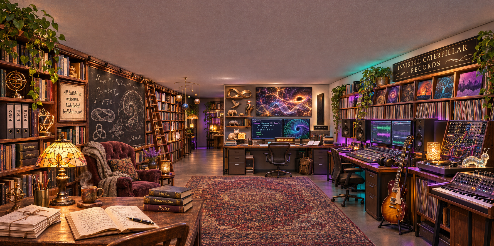

# Dude Physics

**A room. Seventy-two catalog entries. One suspiciously consequential rug.**

An illustrated, affectionate field guide to Matthew Chenoweth Wright's imagined
research-and-music sanctuary—and the conversation in which a Lebowski reference
became **emergent dudeism**. Prepared November 7, 2026, with AI assistance.



This repository combines a personal creative portrait, a documented conversation,
an introduction to the EFMW research program, and explicitly labeled satire.
The room is generated artwork. The rug is real within the picture. Its status as
a universal coupling mechanism is a joke.

## Open the room

Open **[index.html](index.html)** directly in a modern browser. No installation,
account, build, external font, network request or API key is needed. The page has
an original/generated-image switch, a searchable 72-entry inventory, a rug claim
check, the origin story and a guide to the evidence boundaries.

The complete essays also have an offline HTML reader at
**[reading.html](reading.html)**. Markdown sources remain individually editable.

For a local server, run `python3 -m http.server 8000`, then visit
`http://localhost:8000/`. GitHub's file viewer displays HTML source. To host the
page after uploading the package, enable GitHub Pages from `main` and `/(root)`.
The supplied `.nojekyll` keeps it a plain static site. No remote repository or
Pages deployment is created by downloading this archive.

## Read

| File | What it contains |
|---|---|
| [DUDE_PHYSICS.md](DUDE_PHYSICS.md) | The full essay: room, identity, coherence, comedy and the burden of proof |
| [THE_ROOM.md](THE_ROOM.md) | A walk through the three workspaces and their shared floor |
| [INVENTORY.md](INVENTORY.md) | All 72 catalog entries, stable IDs and interpretive uncertainty |
| [EMERGENT_DUDEISM.md](EMERGENT_DUDEISM.md) | The actual conversational sequence and its limits |
| [RUG_THEORY.md](RUG_THEORY.md) | Labeled parody: the rug principle and spontaneous symmetry lounging |
| [EFMW.md](EFMW.md) | The research program, what its formal artifacts establish, and what remains open |
| [CLAIMS.md](CLAIMS.md) | Observations, interpretations, hypotheses and jokes kept distinct |
| [PROVENANCE.md](PROVENANCE.md) | Image origin, editing instructions, counting convention and authorship |
| [SOURCES.md](SOURCES.md) | Inspected primary project sources and exact blob identifiers |
| [LICENSE_NOTICE.md](LICENSE_NOTICE.md) | Rights and attribution boundaries |
| [VERIFICATION.md](VERIFICATION.md) | Package checks, commands and limits |

The numerical identifier **66** belongs to the rug. The number **72** counts
catalog entries, not distinct physical objects, equations, Zoo animals or theorems.
Some entries group whole shelves of books or records.

## Reproduce and check

Requirements: Python 3.10+ and Node.js 20+. No third-party packages.

```sh
python3 build.py --check
node test.cjs
python3 verify.py
```

`inventory.json` is the canonical catalog. `build.py` generates `inventory.js`,
`INVENTORY.md`, `index.html` and `reading.html` from it, `index.template.html`
and the Markdown essays. Run
`python3 build.py` after edits; `--check` detects stale output without rewriting it.
`verify.py` checks local links, image hashes, catalog coverage and generated-file
consistency, then runs the JavaScript checks. The GitHub workflow runs those same
checks. These are package/software checks, not tests of physical EFMW.

For edits and a new ZIP, follow [CONTRIBUTING.md](CONTRIBUTING.md). The optional
`browser_check.py` covers browser interactions when Playwright and Chromium are
available. Its execution status is recorded separately; unit checks do not
substitute for a browser run.

## The rule of the room

> All bullshit is welcome. Unlabeled bullshit is not.

Keep the humor. Keep the original evidence. Keep the right to say **UNRESOLVED**.

Suggested repository name: **Dude-Physics**. This ZIP has no enclosing project
folder: extract its contents straight into the repository root. Only the GitHub
workflow needs a nested path.
